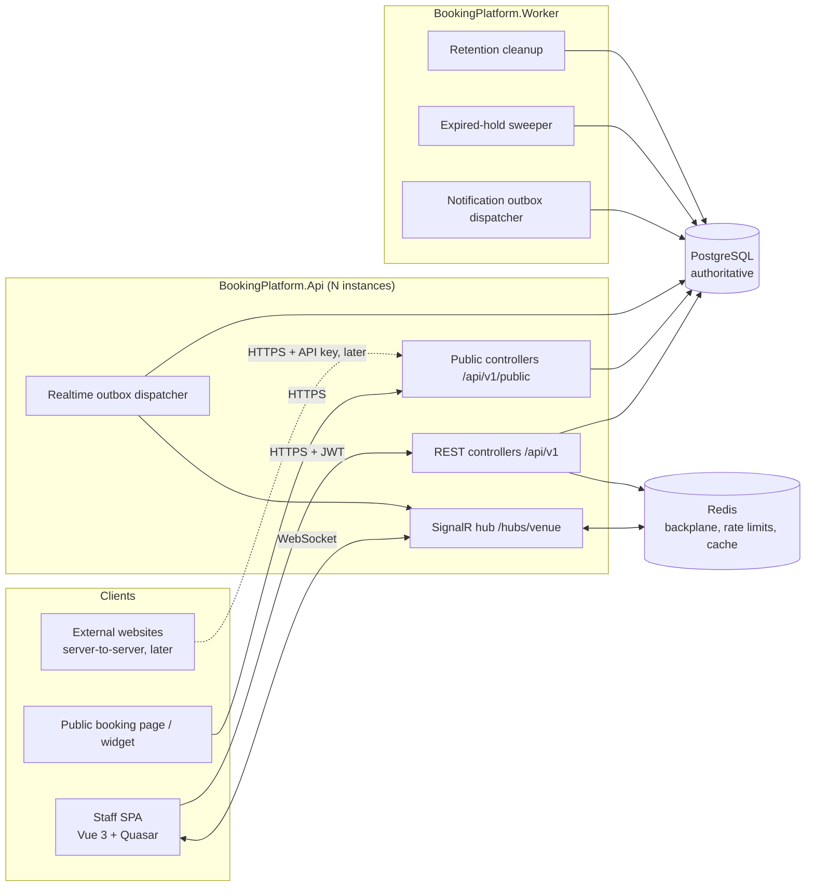

# Architecture

Status: **Phase 0 — approved (2026-10-05).** Runtime: .NET 10 LTS (D-002).

## 1. Goals and priorities

In order: correctness, security, tenant isolation, concurrency safety, maintainability, testability, operational simplicity.
Feature count and speed of delivery come after those.

## 2. Style: modular monolith

One codebase, two runtime processes, one PostgreSQL database, one Redis.



Why not microservices: a booking transaction must atomically touch bookings, allocations, history, audit and outbox.
In one database this is a single ACID transaction; across services it would need sagas and would weaken the double-booking guarantee.

## 3. Backend projects and dependency rules

```
Backend/
  BookingPlatform.Domain          (no dependencies except NodaTime)
  BookingPlatform.Application     -> Domain
  BookingPlatform.Infrastructure  -> Application, Domain   (Npgsql, Dapper, StackExchange.Redis, ...)
  BookingPlatform.Api             -> Application, Infrastructure (composition root only)
  BookingPlatform.Worker          -> Application, Infrastructure (composition root only)
  BookingPlatform.Migrations      (DbUp runner + dev seeder; embeds database/migrations/*.sql)
  Tests/BookingPlatform.UnitTests        -> Domain, Application
  Tests/BookingPlatform.IntegrationTests -> Api, Infrastructure, Migrations (Testcontainers)
```

| Project | Contains | Must not contain |
|---|---|---|
| Domain | Entities, value objects, enums, `BookingStatusMachine`, `OperatingSchedule`, `AvailabilityCalculator`, domain errors | I/O, SQL, HTTP, DI registrations |
| Application | Use-case services (`BookingService`, `AvailabilityService`, ...), commands/queries/DTOs, FluentValidation validators, interfaces (`IUnitOfWork`, `IBookingRepository`, `ITenantContext`, `IOutboxWriter`, ...), permission constants, error codes | SQL, ASP.NET types |
| Infrastructure | Dapper repositories and SQL, `NpgsqlUnitOfWork`, Redis services, JWT/refresh-token services, password hasher adapter, outbox store, SignalR publisher | Business rules |
| Api | Controllers, auth/authorization setup, middleware (correlation id, exception → ProblemDetails, tenant context), hub, health checks, Swagger, rate limiting | SQL, business rules |
| Worker | `BackgroundService`s, composition root | Business rules beyond orchestration |

### Module boundaries inside the monolith

Code is organised by feature folder in each layer so modules could be extracted later:

`Identity` (users, auth, tokens), `Tenancy` (tenants, memberships, roles, permissions), `Venues` (venues, sections, hours),
`Resources` (types, resources, combinations, blocks, floor plans), `Availability`, `Bookings` (bookings, holds, allocations, history),
`Customers`, `Audit`, `Outbox`, `Notifications`, `Realtime`.

Modules talk through Application interfaces, not each other's repositories/tables, except where a single transaction must span them (booking creation writes customer, booking, allocation, audit and outbox — orchestrated by `BookingService` through one unit of work).

## 4. Request pipeline (Api)

1. Correlation/trace id middleware (`X-Correlation-Id` accepted or generated; pushed into Serilog `LogContext`; returned in responses).
2. Security headers, HTTPS redirection/HSTS (non-dev), CORS (explicit origins).
3. Rate limiting (public, auth endpoints).
4. Authentication (JWT bearer; SignalR accepts `access_token` query param on `/hubs/*` only).
5. Tenant context resolution: `ITenantContext` populated from the verified `tid` claim; membership re-validated against a short-lived cache (≤60 s) so revocations take effect quickly.
6. Authorization: permission policies (`[HasPermission(...)]`) + venue access checks in application services.
7. Controller → application service → unit of work → repositories.
8. Global exception handler → ProblemDetails with stable `code`.

## 5. Transactions and unit of work

- `IUnitOfWork` (Infrastructure: `NpgsqlUnitOfWork`) owns one `NpgsqlConnection` + `NpgsqlTransaction` per business operation.
- Application services call `await using var uow = await _uowFactory.BeginAsync(IsolationLevel.ReadCommitted, ct)`, pass it to repositories, and `CommitAsync` at the end.
- READ COMMITTED is sufficient because the exclusion constraint, unique constraints and row locks — not isolation level — enforce the invariants (see `DATABASE.md`).
- Read-only queries (lists, availability) use a plain connection without an explicit transaction.

## 6. Booking engine (summary)

`BookingService.CreateAsync` is the **only** path that creates bookings. Staff, public, widget, phone, API and import sources all call it with a `BookingSource`.

Steps inside one transaction: idempotency claim → resolve venue → validate party size/time/operating hours/booking rules → resolve customer → choose resources (explicit selection or best-fit auto-assignment) → release expired holds overlapping the target → insert booking → insert booking_resources → insert allocations (exclusion constraint is the final arbiter) → status history → booking event → audit log → outbox rows → store idempotency response → commit.

On `23P01` the transaction rolls back and the API returns 409 `RESOURCE_NOT_AVAILABLE`. For auto-assignment, the service uses a savepoint per candidate and tries up to N alternative candidates before returning 409.

Details: `DOMAIN_MODEL.md` (rules), `DATABASE.md` (constraints), `API.md` (contract).

## 7. Availability engine (summary)

`AvailabilityService` loads, in a small fixed number of queries: venue + booking rules, weekly and special hours, eligible resources, active combinations, and active claims overlapping the business-day window.
The pure, unit-tested `AvailabilityCalculator` (Domain) then computes slots and options in memory.
Availability is advisory; the booking transaction always re-validates against PostgreSQL.

## 8. Background processing

| Process | Job | Mechanism |
|---|---|---|
| Api | Realtime outbox dispatcher | Claims `destination = 'REALTIME'` outbox rows with `FOR UPDATE SKIP LOCKED`, publishes via `IHubContext` (Redis backplane fans out to all instances). Woken by `LISTEN outbox` + 1–2 s polling fallback. |
| Worker | Notification outbox dispatcher | Claims `destination = 'NOTIFICATION'` rows; sends via `INotificationSender` abstraction (email/SMS providers pluggable). Exponential backoff, dead-letter after max attempts. |
| Worker | Expired-hold sweeper | Periodically deactivates expired hold allocations, marks holds `EXPIRED`, writes `HoldExpired` outbox rows. Booking transactions also release expired holds lazily, so correctness never depends on sweeper timing. |
| Worker | Retention cleanup | Purges expired idempotency records and old processed outbox rows per `DATABASE.md` retention policy. |

All background services honour `CancellationToken` and shut down gracefully; processing is at-least-once, so handlers are idempotent.

## 9. Caching and Redis usage

| Use | Phase | Notes |
|---|---|---|
| SignalR backplane | 7 | Required as soon as there is more than one Api instance. |
| Rate limiting | 8 | Redis fixed/sliding window counters keyed by IP / account / tenant. |
| Membership/permission cache | 2 | Optional; in-memory cache with short TTL is acceptable for a single instance. |
| Availability cache | Deferred | Only if measurements justify it; short TTL, invalidated by outbox events, never trusted for booking. |

Redis is **not** used for holds (holds are PostgreSQL allocations) and **not** for locks around booking (the exclusion constraint does that). If Redis is down: realtime fan-out degrades and rate limiting falls back to in-memory per instance; bookings keep working.

## 10. Frontend architecture

Quasar CLI (Vite) app at `Frontend/BookingPlatform.Web`, JavaScript, Composition API.

```
src/
  boot/         axios.js (installs http instance), auth.js (silent refresh on startup), signalr.js
  components/   booking/ (BookingForm, BookingDrawer, StatusActions), board/ (TimelineView, FloorPlanView, ListView),
                floorplan/ (FloorPlanCanvas SVG, ResourceShape), common/ (EmptyState, ErrorState, ConfirmDialog)
  composables/  usePermissions, useVenueTime (Intl.DateTimeFormat with venue tz), usePagination, useRealtimeVenue
  constants/    permissions.js, bookingStatus.js, errorCodes.js, realtimeEvents.js
  layouts/      AuthLayout, DashboardLayout, PublicLayout
  pages/        LoginPage, DashboardPage, BookingBoardPage, BookingDetailsPage, AvailabilityPage,
                CustomersPage, CustomerDetailsPage, FloorPlanPage, ResourcesPage, StaffPage, SettingsPage,
                PublicBookingPage, BookingConfirmationPage, ErrorNotFound
  router/       routes.js (meta: requiresAuth, permission, layout), index.js (UX guards)
  services/     http.js (single Axios instance), authService, tenantService, venueService, resourceService,
                availabilityService, bookingService, customerService, floorPlanService, staffService,
                publicBookingService, realtimeService (SignalR connection manager)
  stores/       auth, tenant, venue, resource, booking, availability, customer, floorPlan, realtime
  utils/        idempotency.js (key generation per submit), problemDetails.js, format.js
```

Key behaviours:

- **Tokens**: access token kept in memory (Pinia `auth` store, not localStorage); refresh token in an httpOnly, Secure, SameSite cookie scoped to `/api/v1/auth`. On app boot, `boot/auth.js` calls `/auth/refresh` to restore the session.
- **http.js**: base URL from env, `Authorization` header, `X-Correlation-Id`, single-flight refresh on 401 with request replay, ProblemDetails normalisation into `{ status, code, message, traceId, errors }`.
- **Tenant/venue context**: `tenant` store holds current tenant + memberships (switching calls `/auth/switch-tenant`); `venue` store holds accessible venues and current venue (persisted per user in localStorage as a UX preference only).
- **Realtime**: `realtime` store owns connection state (`connected | reconnecting | disconnected`); on `onreconnected` it re-joins venue groups and triggers resync of the board stores. A visible indicator shows when live updates are paused.
- **Idempotency**: booking forms generate an `Idempotency-Key` when the form is opened/submitted and reuse it for retries of the same submission.
- **Public app**: `PublicLayout` routes under `/book/:tenantSlug/:venueSlug` are lazily loaded and never import dashboard code or stores that require auth.

## 11. Cross-cutting

- **Logging**: Serilog, JSON console sink in containers, enrichers for correlation id, trace id, tenant id, user id (ids only, never PII/tokens). Request logging via `UseSerilogRequestLogging`.
- **Health**: `/health` (liveness, process only), `/health/ready` (PostgreSQL + Redis checks). No configuration values exposed.
- **Configuration**: `appsettings.json` (non-secret defaults) + `appsettings.{Environment}.json` + environment variables + user-secrets in development. Environments: Development, Test, Production.
- **OpenAPI**: Swashbuckle, JWT security scheme, documented ProblemDetails responses, `Idempotency-Key` header parameter.

## 12. Integration boundaries (future)

Notifications (`INotificationSender`), payments (`IPaymentProvider`, Phase 10), external API clients (API keys/service credentials, later), webhooks, POS/CRM/calendar connectors — each behind an Application interface fed by outbox events. The booking engine never calls an external system inside its transaction.
