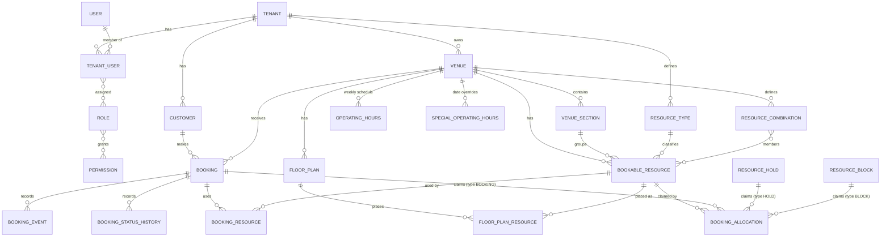

# Domain Model

Status: **Phase 0 — proposed.** Field lists are the intended shape; exact columns are finalised in each phase's migrations and recorded in `DATABASE.md`.

## 1. Overview

## 2. Entities

All tenant-owned entities carry `tenant_id`. All ids are UUIDs. All instants are UTC `TIMESTAMPTZ`.

### Identity & tenancy

| Entity | Key fields | Notes |
|---|---|---|
| **Tenant** | name, slug (unique, URL-safe), status (`ACTIVE`, `SUSPENDED`, `ARCHIVED`), default_time_zone | A business using the SaaS. Slug used by public API. |
| **User** | email (citext, unique), password_hash, display_name, status (`ACTIVE`, `LOCKED`, `DISABLED`), is_platform_admin, failed_login_count, lockout_until, last_login_at | Global identity; may belong to many tenants. |
| **RefreshToken** | user_id, tenant_id, token_hash, family_id, expires_at, revoked_at, replaced_by_id, created_ip, user_agent | Supporting table required by §27 refresh tokens (not a domain aggregate). |
| **TenantUser** | tenant_id, user_id, status (`ACTIVE`, `INVITED`, `DISABLED`) | Membership. Unique (tenant_id, user_id). |
| **Role** | code (`TENANT_OWNER`, ...), name, is_system, tenant_id (null for system roles) | System roles seeded; tenant custom roles possible later. |
| **Permission** | code (`booking.create`, ...), description | Seeded reference data. |
| TenantUserRole / RolePermission | join tables | |
| TenantUserVenue | tenant_user_id, venue_id | Venue-scoped access (D-018). OWNER/ADMIN implicitly access all venues; other roles only assigned venues. |

`PLATFORM_ADMIN` is a platform-level flag (`users.is_platform_admin`), not a tenant role. Platform admins manage tenants; they do **not** get implicit access to tenant booking/customer data (D-010).

### Venues & resources

| Entity | Key fields | Notes |
|---|---|---|
| **Venue** | tenant_id, name, slug (unique per tenant), time_zone (IANA), status, address/contact, booking rules (see §5) | Physical location. |
| **VenueSection** | venue_id, name, sort_order, is_active | Main, VIP, Rooftop... |
| **ResourceType** | tenant_id, code, name, is_active | Table, Booth, Room, Court... Tenant-defined, generic. |
| **BookableResource** | venue_id, section_id, resource_type_id, name, code, min_capacity, capacity, is_active, is_bookable_online, sort_order, attributes (JSONB, display-only) | The reservable unit. |
| **ResourceCombination** | venue_id, name, min_capacity, capacity, is_active, is_bookable_online | E.g. "Table 5 + 6" for 8 guests. |
| ResourceCombinationMember | combination_id, resource_id, is_required | Required members must all be free; optional members are only allocated when explicitly selected by staff. |
| **ResourceBlock** | venue_id, reason (`MAINTENANCE`, `PRIVATE_EVENT`, `CLEANING`, `MANAGEMENT`, `UNAVAILABLE`, `STAFF_USE`), notes, starts_at, ends_at, status (`ACTIVE`, `CANCELLED`), created_by | Covers one or more resources via allocations. |
| **FloorPlan** | venue_id, name, width, height, background (JSONB visual metadata), is_active | Presentation only. |
| **FloorPlanResource** | floor_plan_id, resource_id, x, y, width, height, rotation, shape, visual (JSONB) | Unique (floor_plan_id, resource_id). |
| **OperatingHours** | venue_id, day_of_week (ISO 1–7), open_time, close_time, sort_order | Multiple periods per day allowed (lunch + dinner). `close_time <= open_time` ⇒ period ends next day. |
| **SpecialOperatingHours** | venue_id, date, is_closed, open_time, close_time, name | Replaces the weekly schedule for that business date. |

### Customers & bookings

| Entity | Key fields | Notes |
|---|---|---|
| **Customer** | tenant_id, first_name, last_name, email, phone, phone_normalized, notes (staff-only), preferences (JSONB, minimal), marketing_consent, anonymized_at | Shared across a tenant's venues. Minimal PII. |
| **Booking** | tenant_id, venue_id, customer_id, reference, status, source, party_size, starts_at, ends_at, business_date, special_requests, internal_notes, public_token_hash, created_by_user_id, version, cancelled_at, cancellation_reason | Never deleted. |
| **BookingResource** | booking_id, resource_id, combination_id (nullable) | Which resources the booking is assigned to. |
| **BookingAllocation** | resource_id, allocation_type (`BOOKING`, `HOLD`, `BLOCK`), booking_id / hold_id / block_id (exactly one), starts_at, ends_at, period (generated `tstzrange`), expires_at (holds), is_active, released_at, release_reason | **The time claim on a resource.** Protected by the exclusion constraint. |
| **ResourceHold** | venue_id, owner_reference (session/user), token_hash, party_size, starts_at, ends_at, expires_at, status (`ACTIVE`, `CONVERTED`, `RELEASED`, `EXPIRED`), converted_booking_id | Short-lived (default 5 min). |
| **BookingStatusHistory** | booking_id, from_status, to_status, changed_by_user_id, source, reason, changed_at | Every status change. |
| **BookingEvent** | booking_id, event_type (`CREATED`, `UPDATED`, `MOVED`, `STATUS_CHANGED`, `CANCELLED`, `NOTE_ADDED`), data (JSONB), actor, occurred_at | Business timeline for the booking. |

### Platform

| Entity | Key fields | Notes |
|---|---|---|
| **AuditLog** | tenant_id, user_id, entity_type, entity_id, action, old_values, new_values (JSONB, redacted), ip, user_agent, correlation_id, created_at | Append-only. |
| **OutboxMessage** | tenant_id, destination (`REALTIME`, `NOTIFICATION`), type, payload (JSONB), status, attempt_count, available_at, locked_until, processed_at, last_error | Written in the business transaction. |
| **IdempotencyKey** | tenant_id, scope, key, request_hash, status, response_status, response_body, resource_id, expires_at | Unique (tenant_id, scope, key). |

## 3. Booking vs. BookingResource vs. BookingAllocation

- **Booking** — the customer-facing reservation (who, how many, when, status).
- **BookingResource** — the assignment: which resources (and via which combination) the booking uses. Survives cancellation for history.
- **BookingAllocation** — the time claim: "resource R is occupied during [start, end)". Only *active* allocations occupy a resource. Holds and blocks create allocations too, so a single database constraint protects all three.

A booking for a party of 8 on combination "Table 5 + 6" has one Booking, two BookingResources, two BookingAllocations.

## 4. Booking status machine

Implemented once in Domain (`BookingStatusMachine`) and used by every command. The API exposes explicit commands, never "set status".

| From \ To | PENDING | HELD | CONFIRMED | CHECKED_IN | SEATED | COMPLETED | CANCELLED | NO_SHOW |
|---|---|---|---|---|---|---|---|---|
| (new) | ✓ | ✓ | ✓ | | ✓ (walk-in) | | | |
| PENDING | | | ✓ confirm | | | | ✓ cancel | |
| HELD | | | ✓ confirm | | | | ✓ cancel / expire | |
| CONFIRMED | | | | ✓ check-in | ✓ seat | | ✓ cancel | ✓ no-show |
| CHECKED_IN | | | | | ✓ seat | | ✓ cancel | |
| SEATED | | | | | | ✓ complete | | |
| COMPLETED | terminal | | | | | | | |
| CANCELLED | terminal | | | | | | | |
| NO_SHOW | terminal | | | | | | | |

Semantics:

- `PENDING` — awaiting venue approval (e.g. public bookings when the venue disables auto-confirm, or large parties). Occupies resources.
- `HELD` — provisional booking awaiting an external step (deposit payment in Phase 10). Occupies resources; has an expiry.
- Walk-ins are created directly as `SEATED` with source `WALK_IN`.
- Active (resource-occupying) statuses: `PENDING`, `HELD`, `CONFIRMED`, `CHECKED_IN`, `SEATED`.
- `CANCELLED`, `NO_SHOW` → allocations deactivated (`is_active = false`, `released_at`, `release_reason`), never deleted.
- `COMPLETED` → if completed before the planned end, the allocation's `ends_at` is truncated to the completion instant so the resource frees up; history keeps the original times in `booking_events`.
- Reinstating a terminal booking is **not** supported initially (it would require re-allocation); deferred and tracked in `DEVELOPMENT_PHASES.md`.

Every transition writes `booking_status_history`, a `booking_event`, an `audit_log` row and outbox messages.

## 5. Booking rules (per venue)

Stored as typed columns on `venues` (not JSON), with sensible defaults:

| Rule | Default |
|---|---|
| slot_interval_minutes | 15 |
| default_duration_minutes | 120 |
| min_duration_minutes / max_duration_minutes | 30 / 480 |
| turnover_buffer_minutes (added to allocation end) | 0 |
| min_party_size / max_party_size (public) | 1 / 12 |
| min_lead_time_minutes (public) | 60 |
| max_advance_days (public) | 90 |
| hold_ttl_seconds | 300 |
| auto_confirm_public_bookings | true |
| public_booking_enabled | true |
| public_cancellation_cutoff_minutes (0–10080) | 120 |

Public bookings additionally: start on the slot grid of their period, use the default duration, are assigned only online-bookable resources/combinations, and a guest may hold at most `PublicBooking:MaxActiveBookingsPerContact` (3) upcoming active bookings per venue. Guests may cancel `PENDING`/`HELD`/`CONFIRMED` bookings online until `starts_at − public_cancellation_cutoff_minutes`.

Staff with `booking.create` may override public-only limits (lead time, max party) but never operating hours unless explicitly flagged as an out-of-hours booking (deferred) — and never the allocation constraint.

## 6. Operating hours and business dates

- A **business date** is the venue-local date on which an operating period *starts*. Friday `18:00 → 02:00` belongs to Friday; a 01:00 Saturday booking has business_date = Friday.
- For a business date D, the effective periods are: SpecialOperatingHours for D if any exist (closed or custom), else the weekly OperatingHours for D's weekday.
- Each period converts to a UTC interval: start = `D + open_time` in venue tz; end = (`D` or `D+1` if `close_time <= open_time`) + `close_time` in venue tz.
- DST resolution: nonexistent local time → shifted forward to the first valid instant; ambiguous → earlier offset.
- A booking is within hours if `[starts_at, ends_at)` lies inside one effective period. (Allowing bookings to overrun closing is a possible future rule.)

## 7. Availability

Inputs: venue, business date, party size, duration (default from venue), optional requested time, optional section, optional resource type.

1. Compute effective periods (§6). Closed → no slots.
2. Candidate start times every `slot_interval_minutes` such that `[t, t + duration)` fits a period, and (public) `t ≥ now + lead time`.
3. Eligible single resources: active, in venue, matching filters, `min_capacity ≤ party ≤ capacity`.
4. Eligible combinations: active, `min_capacity ≤ party ≤ capacity`, all required members active.
5. Load active claims overlapping the day window (active allocations, excluding expired holds and the caller's own hold).
6. For each slot: a resource is free if no claim overlaps `[t, t + duration + turnover)`; a combination is free if all required members are free.
7. Rank options: single resources before combinations; then smallest sufficient capacity; then sort order.
8. Output: slots with availability flag and options (staff API) or only times (public API).

## 8. Holds

- Created for specific resources and a time range; produce `HOLD` allocations with `expires_at = now + hold_ttl`.
- Converting: booking create with `holdToken` → in the same transaction, hold allocations deactivated (`CONVERTED`) and booking allocations inserted.
- Expiry: lazily released by any allocation transaction touching the same resources/time, and by the sweeper.

## 9. Invariants (who enforces them)

| Invariant | Enforced by |
|---|---|
| No two active allocations on the same resource overlap in time | **DB exclusion constraint** |
| Allocation, booking, resource, customer belong to the same tenant | DB composite FKs `(tenant_id, id)` + tenant-scoped SQL |
| `ends_at > starts_at`, capacities positive, `min_capacity ≤ capacity` | DB check constraints + validators |
| Exactly one of booking/hold/block per allocation, matching type | DB check constraint |
| Booking reference unique | DB unique constraint |
| Valid status transitions | Domain `BookingStatusMachine` + command endpoints |
| Party size fits resource/combination capacity | Domain + application validation |
| Booking within operating hours | Domain `OperatingSchedule` |
| No partial combination allocation | Single transaction; any conflict rolls back all allocations |
| Idempotent creation | DB unique (tenant_id, scope, key) + request hash |

## 10. Booking reference

Format `BK-{yyyyMMdd}-{n}` where the date is the venue-local business date and `n` comes from a global PostgreSQL sequence, zero-padded to 6 digits (grows as needed). Unique constraint on `reference`. The reference is not a secret: public confirmation/manage links use a separate unguessable token (an HMAC of the booking id under a dedicated key, stored hashed — D-066).
